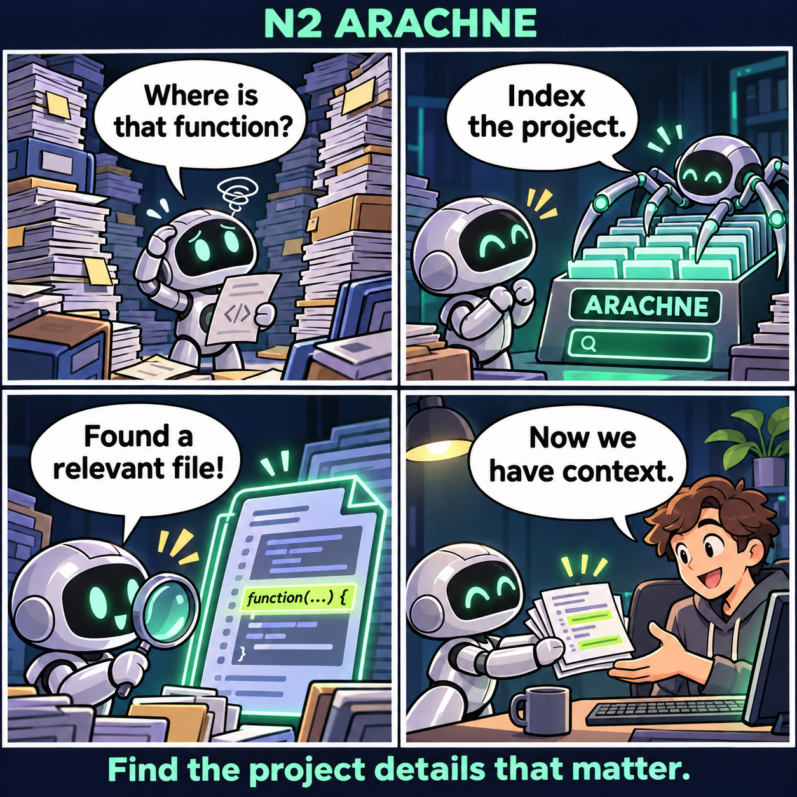
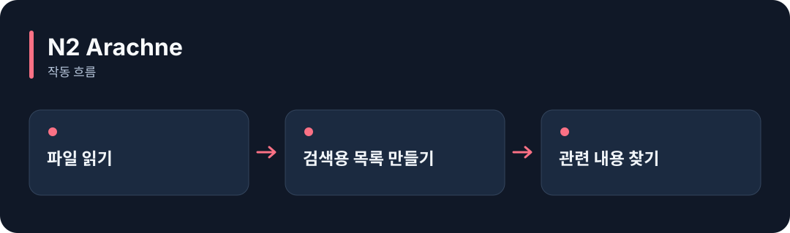

# N2 Arachne

**프로젝트의 코드와 문서를 검색해, AI가 지금 읽어야 할 부분을 찾아줍니다.**

[](https://github.com/choihyunsus/n2-arachne/releases/tag/v5.0.0) [](https://github.com/choihyunsus/n2-arachne/blob/main/docs/reference.ko.md) [](https://github.com/choihyunsus/n2-arachne/blob/main/LICENSE)

[English](README.md)

<p align="center">
  
</p>

많은 파일에서 함수를 찾다가 → 검색 목록을 만들고 → 관련 내용을 찾아 → 필요한 소스를 읽습니다.

기능을 이야기로 표현한 만화입니다. 실제 앱 화면은 아닙니다.

<details>
<summary>동작 흐름 펼쳐 보기</summary>



</details>

## 이런 때 사용하세요

파일이 많은 프로젝트에서 특정 함수나 설정을 찾거나, 질문과 관련된 내용을 모아 모델에 전달할 때 사용하세요.

검색 전에 폴더를 색인합니다. 색인은 파일을 검색하기 쉽게 목록으로 만드는 과정입니다. PDF·Office 파일을 읽는 기능은 운영체제별 파서 준비가 필요할 수 있습니다.

## 처음 실행하기

터미널에서 `node --version`을 실행해 Node.js 22 이상인지 확인하세요. 아래 명령은 새 연습 폴더를 만들고 GitHub 배포 파일을 설치합니다. 예제 파일과 DB도 이 폴더에 두면 경로를 따라가기 쉽습니다.

```sh
mkdir n2-arachne-demo
cd n2-arachne-demo
npm init -y
npm install https://github.com/choihyunsus/n2-arachne/releases/download/v5.0.0/n2-arachne-5.0.0.tgz
```

설치 중 SQLite 빌드 오류가 나오면 운영체제에 맞는 C/C++ 빌드 도구가 필요할 수 있습니다. 자세한 환경 조건은 [설치 참고](https://github.com/choihyunsus/n2-arachne/blob/main/docs/reference.ko.md)에 있습니다.

아래 내용을 `demo.mjs`로 저장하세요. 파일은 방금 설치 명령을 실행한 폴더에 둡니다.

```js
import { mkdirSync, writeFileSync } from 'node:fs';
import { resolve } from 'node:path';
import { Store, Indexer, loadConfig } from 'n2-arachne';
mkdirSync('./source', { recursive: true });
writeFileSync('./source/greeting.ts', 'export function greeting() { return \'Hello\'; }\n');
const store = new Store('./memory', {
  dbPath: './demo.db', project: 'demo', agent: 'assistant', projectRoot: resolve('./source'),
});
try {
  await store.init();
  const result = await new Indexer(store, loadConfig()).index(resolve('./source'));
  console.log(result.complete);
  console.log(store.searchChunks('greeting').map(chunk => chunk.content));
} finally {
  store.close();
}
```

```sh
node demo.mjs
```

완료 값 `true`와 `greeting` 함수가 들어 있는 검색 결과가 출력됩니다. 이후 자신의 소스 폴더로 경로를 바꿔 사용할 수 있어요.

## Soul과 함께 쓰기

여러 N2 모듈을 연결할 때 같은 `mimir.db` 파일을 지정하세요. `project`는 작업 이름, `agent`는 계속 사용할 AI 이름입니다. 같은 작업의 기록을 이어 쓰려면 이 값들을 맞춥니다. 단독 사용도 같은 필드 구조를 사용합니다.

## 다음 단계와 상세 안내

[전체 사용 안내](https://github.com/choihyunsus/n2-arachne/blob/main/docs/reference.ko.md)에서 실제 앱 연결, API, 지원 범위, 복구 절차와 검증 범위를 확인할 수 있습니다. [배포 파일](https://github.com/choihyunsus/n2-arachne/releases/tag/v5.0.0)에는 설치할 버전과 변경 설명이 있습니다.

처음 나오는 용어는 이렇게 읽으면 됩니다. **MCP**는 AI 앱의 도구 연결 방식, **DB**는 저장 파일, **호스트**는 이 모듈을 연결해 실행하는 앱입니다.

사용·재배포 조건은 [라이선스](https://github.com/choihyunsus/n2-arachne/blob/main/LICENSE)를 확인하세요. 의존 모듈에는 별도 조건이 적용될 수 있으며, 상업 이용 조건은 상세 안내에 함께 설명되어 있습니다.
