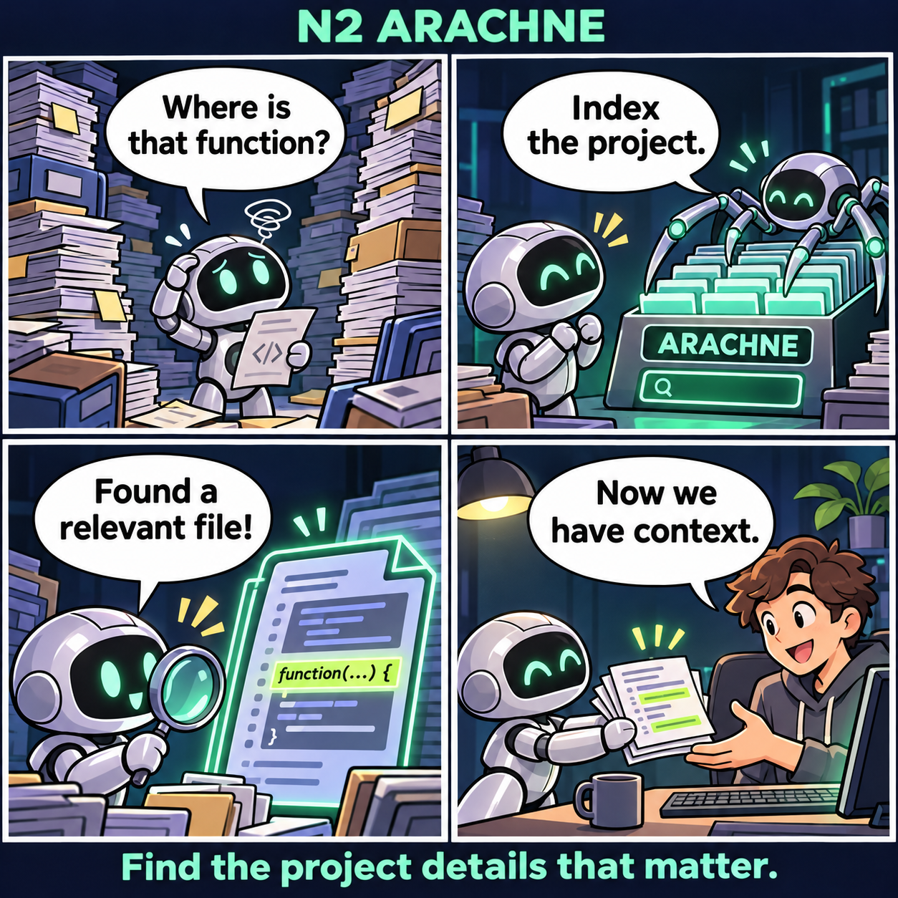
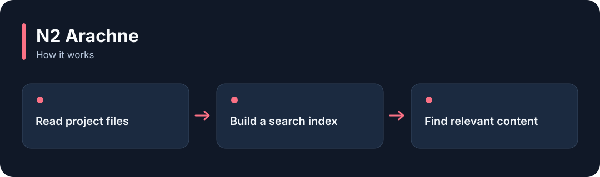

# N2 Arachne

**Search project code and documents to find the parts an AI should read for the current task.**

[](https://github.com/choihyunsus/n2-arachne/releases/tag/v5.0.0) [](https://github.com/choihyunsus/n2-arachne/blob/main/docs/reference.md) [](https://github.com/choihyunsus/n2-arachne/blob/main/LICENSE)

[한국어](README.ko.md)

<p align="center">
  
</p>

Search project code and documents to find the parts an AI should read for the current task.

A story illustrating the feature, rather than a screenshot of the app.

<details>
<summary>View the workflow</summary>



</details>

## When to use it

Find a function or setting in a large project, or gather relevant passages for a model request.

Index the folder before searching. Indexing builds a searchable record of its files. Reading PDF and Office documents may require a platform-specific parser build.

## Try it

Run `node --version` in a terminal and check for Node.js 22 or later. These commands create a fresh practice folder and install the GitHub release. Keep the example file and database in this folder.

```sh
mkdir n2-arachne-demo
cd n2-arachne-demo
npm init -y
npm install https://github.com/choihyunsus/n2-arachne/releases/download/v5.0.0/n2-arachne-5.0.0.tgz
```

If installation reports a SQLite build error, you may need your platform’s C/C++ build tools. See the [installation reference](https://github.com/choihyunsus/n2-arachne/blob/main/docs/reference.md) for platform requirements.

Save the following as `demo.mjs` in the folder where you ran the install command.

```js
import { mkdirSync, writeFileSync } from 'node:fs';
import { resolve } from 'node:path';
import { Store, Indexer, loadConfig } from 'n2-arachne';
mkdirSync('./source', { recursive: true });
writeFileSync('./source/greeting.ts', 'export function greeting() { return \'Hello\'; }\n');
const store = new Store('./memory', {
  dbPath: './demo.db', project: 'demo', agent: 'assistant', projectRoot: resolve('./source'),
});
try {
  await store.init();
  const result = await new Indexer(store, loadConfig()).index(resolve('./source'));
  console.log(result.complete);
  console.log(store.searchChunks('greeting').map(chunk => chunk.content));
} finally {
  store.close();
}
```

```sh
node demo.mjs
```

The completion flag is `true`, and search results include the `greeting` function. Then point the indexer at your own source folder.

## Using it with Soul

Point connected N2 modules at the same `mimir.db` file. `project` names the work and `agent` names the AI identity you will keep using. Match those values to continue working with the same records. Standalone use follows the same field layout.

## Next steps and reference

The [full reference](https://github.com/choihyunsus/n2-arachne/blob/main/docs/reference.md) covers app integration, APIs, supported features, recovery and validation. The [release page](https://github.com/choihyunsus/n2-arachne/releases/tag/v5.0.0) contains the installable version and release notes.

A few terms used in the reference: **MCP** connects tools to an AI app, a **database** stores records, and the **host** is the app that connects and runs this module.

Review the [license](https://github.com/choihyunsus/n2-arachne/blob/main/LICENSE) for use and redistribution. Dependencies can have their own terms, including commercial-use conditions described in the reference.
